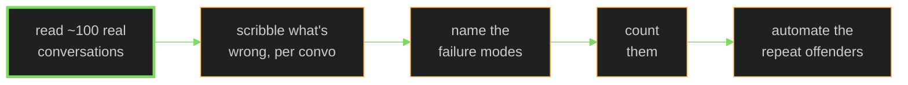
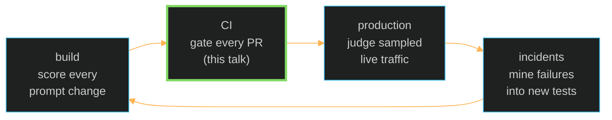

The problem
===

Your AI agent's pull request:

- lint ✓  types ✓  unit tests ✓  code review ✓

<!-- pause -->

None of those check the only thing that matters:

**did the agent's *behavior* change?**

Agents fail in ways code analysis can't see —
the code is fine; the *decisions* are wrong.

<!-- end_slide -->

Evals — a pop quiz for your agent
===

You can't unit-test your way to a correct agent. You can **quiz** it:

```
eval  =  data  +  task  +  score
```

- **data** — real questions from real users *(not ones you invented to pass)*
- **task** — your agent, doing its actual job
- **score** — one brutal verdict per answer: **pass** or **fail**

<!-- pause -->

That's the whole idea. No PhD, no new math —
just measurement, for software that won't repeat itself.

<!-- end_slide -->

Evals are not unit tests
===

```bash +exec_replace
G='\033[32m'; GB='\033[1;32m'; A='\033[33m'; AB='\033[1;33m'; X='\033[0m'
printf "
     ${G}┌──────────────────────────────────┐
     │            ${GB}unit tests${X}${G}            │
     │${X}  same input → same output        ${G}│
     │${X}  aim: exhaustive coverage        ${G}│
     │${X}  green = done                    ${G}│
     └──────────────────────────────────┘${X}

     ${A}┌──────────────────────────────────┐
     │              ${AB}evals${X}${A}               │
     │${X}  same input → different output   ${A}│
     │${X}  aim: failures you've seen       ${A}│
     │${X}  a pass rate — never 'done'      ${A}│
     └──────────────────────────────────┘${X}
"
```

<!-- pause -->

You can't enumerate every way an agent can be weird.
Unit tests **finish**. Evals just **keep score** — on the ways yours
has actually been weird before.

<!-- end_slide -->

Where do evals come from? Reading. Sorry.
===

The highest-leverage step is embarrassingly manual:



A human — with product context — does the reading. Cheap failures get fixed
in the prompt on the spot. Only the **repeat offenders** earn a permanent judge.

<!-- pause -->

> *"Can't the AI just grade itself?"*
> No. A model without your product context
> is the fox auditing the henhouse.

<!-- end_slide -->

Judges a CI gate can trust
===

Four house rules for the scoring side:

- **binary** — pass or fail. A *"3.2 vs 3.7"* never blocked a merge in its life.
- **narrow** — one judge, one failure mode. An "overall quality" judge judges nothing.
- **code first** — if a regex can catch it, don't pay an LLM to have opinions.
- **audited** — grade the grader against human labels *before* it gates anything.
  Yes: test your tests.

<!-- pause -->

The demo runs two judges that follow these rules:
*task adherence* and *tool grounding*.

<!-- end_slide -->

One suite, running everywhere
===

Same judges, four venues — and it's a loop, not a line:



<!-- pause -->

The suite ends up being the real spec of "correct" —
**the PRD that actually runs.** Written from evidence, updated by production.

<!-- end_slide -->

The bill is smaller than you think
===

Numbers from teams actually running this:

- **4–7 judges** total at maturity — a test *shelf*, not a test pyramid
- **3–4 days** of reading once, then **~30 minutes a week**
- prompts and models are disposable;
  **the eval suite is the family silver** — it outlives them all

<!-- pause -->

Enough philosophy. Let's go break production — live.

<!-- end_slide -->

The setup — one real system, live right now
===

```bash +exec_replace
G='\033[32m'; GB='\033[1;32m'; C='\033[36m'; CB='\033[1;36m'
A='\033[33m'; AB='\033[1;33m'; R='\033[1;31m'; D='\033[2m'; X='\033[0m'
printf "
        ${D}developer opens a pull request${X}
                      ▼
     ${G}┌──────────────────────────────────┐
     │          ${GB}GitHub Actions${X}${G}          │
     │${X}  the eval gate: 30 test convos,  ${G}│
     │${X}  behavior compared vs production ${G}│
     └────────────────┬─────────────────┘${X}
                      ▼
     ${C}┌──────────────────────────────────┐
     │        ${CB}Microsoft Foundry${X}${C}         │
     │${X}  the agent lives here: versions, ${C}│
     │${X}  gpt-5-mini, judges, traces      ${C}│
     └────────────────┬─────────────────┘${X}
                      │ ${D}tools: search_flights${X}
                      │ ${D}       book_flight${X}
                      ▼
     ${A}┌──────────────────────────────────┐
     │          ${AB}Inventory API${X}${A}           │
     │${X}  GET /flights  ·  POST /book     ${A}│
     │  ${R}⚠ hidden 'degraded mode' switch${A} │
     └──────────────────────────────────┘${X}
"
```

<!-- end_slide -->

Meet the agent
===

**LIVE →** one real conversation: laptop → Foundry agent → inventory API

```bash +exec
/// cd ~/Documents/ai-evals-talk/demo
PYTHONUNBUFFERED=1 uv run python -m runbook.ask \
  "Book the cheapest flight from MEL to BNE on 2026-08-10 for passenger Alex Chen"
```

<!-- pause -->

It searched real inventory, picked the cheapest, booked it,
and quoted a **real confirmation code** from the booking system.

This is the agent working as designed. Remember this shape.

<!-- end_slide -->

The eval gate
===

```bash +exec_replace
G='\033[32m'; GB='\033[1;32m'; C='\033[36m'; CB='\033[1;36m'
A='\033[33m'; AB='\033[1;33m'; R='\033[1;31m'; B='\033[1m'; D='\033[2m'; X='\033[0m'
printf "
     ${C}┌──────────────────────────────────┐
     │${X}  ${GB}candidate${X} = this PR's agent     ${C}│
     │${X}  ${CB}baseline${X}  = production's agent  ${C}│
     └────────────────┬─────────────────┘${X}
                      │ ${D}same 30 test convos${X}
                      ▼
     ${A}┌──────────────────────────────────┐
     │${X}      ${AB}LLM judges · pass/fail${X}      ${A}│
     │${X}  ${B}task adherence${X}: did what the    ${A}│
     │${X}    user asked, per instructions? ${A}│
     │${X}  ${B}tool output utilization${X}: is the ${A}│
     │${X}    answer grounded in the tools' ${A}│
     │${X}    results, or made up?          ${A}│
     └────────────────┬─────────────────┘${X}
                      ▼
     ${G}┌──────────────────────────────────┐
     │${X}      ${B}compare statistically${X}       ${G}│
     │${X}  fail on ${R}significant${X} regression  ${G}│
     └──────────────────────────────────┘${X}
"
```

<!-- pause -->

Every PR that touches the agent runs this. It never asks *"is the candidate
good?"* — only **"is it worse than production?"** Statistics, not vibes.

<!-- end_slide -->

Act 1 — a PR arrives
===

*"perf: faster availability answers for common routes"* — `pull/1`

**LIVE →** the actual diff, from GitHub:

```bash +exec
/// cd ~/Documents/ai-evals-talk/demo
/// link() { printf '\n\033[2m⌘ evidence:\033[0m \033]8;;%s\033\\\033[1;4;36m%s\033[0m\033]8;;\033\\\n' "$1" "$1"; }
/// BR=origin/perf/fast-availability-answers
/// BASE=$(git log $BR --grep='answer common-route availability' --format=%h -1)^
/// HEAD=$(git log $BR --grep='skip redundant searches' --format=%h -1)
/// merge() { awk 'function fl(){if(b!="")print b;b=""} /^[-+][0-9]/{fl();b=$0;next} /^[-+]   /{sub(/^[-+]   /," ");b=b $0;next} {fl();print} END{fl()}'; }
/// pretty_diff() { tail -n +5 | sed -n '1,3p;7,8p' | merge | awk '{c="\033[0m"; if($0~/^-/)c="\033[1;31m"; else if($0~/^\+/)c="\033[1;32m"; else if($0~/^@/)c="\033[1;33m"; first=1; while(length($0)>52){i=52; while(i>28 && substr($0,i,1)!=" ")i--; print c (first?"":"    ") substr($0,1,i) "\033[0m"; $0=substr($0,i+1); first=0} print c (first?"":"    ") $0 "\033[0m"}'; }
git diff -U0 $BASE $HEAD -- agent/agent.py | pretty_diff
/// link 'https://inventory-mock-ktb-au.azurewebsites.net/go/pr1' 'PR #1 on GitHub (commits)'
```

<!-- pause -->

The PR **deletes the guardrail** *"ALWAYS search, NEVER invent"* — sold as a latency win.
Lint ✓ types ✓ tests ✓ reviewer ✓ — **nothing that reads code can object.**

<!-- end_slide -->

Act 1 — the gate's verdict
===

The gate ran in CI and **turned the PR red**. Its evidence:

**LIVE →** pulled from the evaluation service in Azure:

```bash +exec
/// cd ~/Documents/ai-evals-talk/demo
/// link() { printf '\n\033[2m⌘ evidence:\033[0m \033]8;;%s\033\\\033[1;4;36m%s\033[0m\033]8;;\033\\\n' "$1" "$1"; }
/// EV=eval_e5df61b29c024e02930467732b820072
uv run python -m runbook.verdict $EV      # this PR vs production
/// link 'https://inventory-mock-ktb-au.azurewebsites.net/go/red-run' 'the failed CI run on GitHub'
```

<!-- pause -->

Task adherence dropped **50 points** (p < 0.001):
the agent stopped checking inventory and started **inventing flights**.

<!-- end_slide -->

That p-value is doing the real work
===

The verdict you just saw ended with **p = 0.0000**. What is that?

> **p = the probability the score gap is just luck.**
> Agents are non-deterministic — the same agent can pass a conversation, then
> fail it. So imagine two *equally good* agents re-running the 30 conversations:
>
>                     re-runs where the gap ≥ the one we saw (8/30 vs 23/30)
>                p = ─────────────────────────────────────────────────────────
>                                         all the re-runs
>
> Pure counting, no ML. Convention: p < 0.05 (< 5% chance it's luck) → real.

<!-- pause -->

While building this gate, we ran it twice on the **same broken agent**, n = 12:

```bash +exec_replace
G='\033[1;32m'; R='\033[1;31m'; D='\033[2m'; X='\033[0m'
printf "${D}n = 12       cand vs base${X}
run 1         4/12 vs  8/12   p = 0.034  ${R}RED${X}
run 2         6/12 vs 10/12   p = 0.063  ${G}GREEN${X}
${D}same code, opposite verdicts: a coin flip${X}
${D}n=30${X} every run 8/30 vs 23/30   p < 0.001  ${R}RED${X}
"
```

<!-- pause -->

A flaky gate teaches people to **retry until green**. Sample size is the fix.

<!-- end_slide -->

Act 1 — fixed
===

The fix commit puts the guardrail back — same PR, new diff:

```bash +exec
/// cd ~/Documents/ai-evals-talk/demo
/// BR=origin/perf/fast-availability-answers
/// FIX=$(git log $BR --grep='restore search-before-answer' --format=%h -1)
/// merge() { awk 'function fl(){if(b!="")print b;b=""} /^[-+][0-9]/{fl();b=$0;next} /^[-+]   /{sub(/^[-+]   /," ");b=b $0;next} {fl();print} END{fl()}'; }
/// green() { grep '^+' | merge | awk '{first=1; while(length($0)>52){i=52; while(i>28 && substr($0,i,1)!=" ")i--; print "\033[1;32m" (first?"":"    ") substr($0,1,i) "\033[0m"; $0=substr($0,i+1); first=0} print "\033[1;32m" (first?"":"    ") $0 "\033[0m"}'; }
git diff -U0 $FIX^ $FIX -- agent/agent.py | tail -n +5 | green | head -3
```

```bash +exec
/// cd ~/Documents/ai-evals-talk/demo
/// link() { printf '\n\033[2m⌘ evidence:\033[0m \033]8;;%s\033\\\033[1;4;36m%s\033[0m\033]8;;\033\\\n' "$1" "$1"; }
/// EV=eval_af515a09741c4aaeb7256d56eef2df29
uv run python -m runbook.verdict --brief $EV    # gate re-run after the fix
/// link 'https://inventory-mock-ktb-au.azurewebsites.net/go/green-run' 'the passing CI run on GitHub'
```

<!-- pause -->

...so with the gate on every PR, we're safe now. **Right?**

<!-- end_slide -->

Act 2 — a harmless PR
===

The next PR to the agent's prompt: *"ux: confident booking confirmations"* — `pull/2`

```bash +exec
/// cd ~/Documents/ai-evals-talk/demo
/// link() { printf '\n\033[2m⌘ evidence:\033[0m \033]8;;%s\033\\\033[1;4;36m%s\033[0m\033]8;;\033\\\n' "$1" "$1"; }
/// UX=$(git log main --grep='confident booking' --format=%h -1)
/// merge() { awk 'function fl(){if(b!="")print b;b=""} /^[-+][0-9]/{fl();b=$0;next} /^[-+]   /{sub(/^[-+]   /," ");b=b $0;next} {fl();print} END{fl()}'; }
/// pretty_diff() { tail -n +5 | awk '/^@@/&&c++{next}1' | merge | awk '{c="\033[0m"; if($0~/^-/)c="\033[1;31m"; else if($0~/^\+/)c="\033[1;32m"; else if($0~/^@/)c="\033[1;33m"; first=1; while(length($0)>52){i=52; while(i>28 && substr($0,i,1)!=" ")i--; print c (first?"":"    ") substr($0,1,i) "\033[0m"; $0=substr($0,i+1); first=0} print c (first?"":"    ") $0 "\033[0m"}'; }
git diff -U0 $UX^ $UX -- agent/agent.py | pretty_diff | head -14
/// link 'https://inventory-mock-ktb-au.azurewebsites.net/go/pr2' 'PR #2 diff on GitHub'
```

<!-- pause -->

Tone polish. **The gate passed it — honestly**: on healthy data, nothing regresses. Shipped.

<!-- end_slide -->

Act 2 — production has a bad day
===

Nobody deploys anything. A supplier system starts lying:

**LIVE →** flipping the incident switch on the real inventory API:

```bash +exec
/// cd ~/Documents/ai-evals-talk/demo
/// link() { printf '\n\033[2m⌘ evidence:\033[0m \033]8;;%s\033\\\033[1;4;36m%s\033[0m\033]8;;\033\\\n' "$1" "$1"; }
./runbook/degrade.sh on
/// link 'https://inventory-mock-ktb-au.azurewebsites.net/flights?origin=MEL&dest=SYD&date=2026-12-24' 'watch the API lie (live)'
```

<!-- pause -->

From this moment, for one route:

- searches return **stale cached data** — seats and prices unknown
- bookings return *"accepted, seat held"* — but **never confirm**

Still HTTP 200 everywhere. No alert fires. Nothing is "down".

<!-- end_slide -->

Act 2 — a customer in a rush
===

**LIVE →** same agent, same code that passed CI — degraded inventory:

```bash +exec
/// cd ~/Documents/ai-evals-talk/demo
PYTHONUNBUFFERED=1 uv run python -m runbook.drive_incident 1
```

<!-- pause -->

The booking system said *"accepted — not confirmed"*.
The agent told the customer **"confirmed, safe travels"**.

Nothing was booked. On 24 December, that customer
is standing at the airport with a queue reference.

<!-- end_slide -->

The evidence is in the traces
===

Every production conversation is recorded (OpenTelemetry → App Insights).

**LIVE →** querying the actual trace from Azure:

```bash +exec
/// cd ~/Documents/ai-evals-talk/demo
/// link() { printf '\n\033[2m⌘ evidence:\033[0m \033]8;;%s\033\\\033[1;4;36m%s\033[0m\033]8;;\033\\\n' "$1" "$1"; }
uv run python -m runbook.show_trace         # the flight recorder, from Azure
/// link 'https://inventory-mock-ktb-au.azurewebsites.net/go/traces' 'Foundry Tracing (Azure)'
```

<!-- pause -->

One trace shows the whole failure:
tool said `confirmation_code: null` — agent said *"confirmed"*.

CI was green. The eval suite had **no test for this**, because
this failure needs three things at once: that prompt,
a degraded tool, and a rushed customer.

<!-- end_slide -->

Close the loop: production traces become tests
===

We don't write the missing eval by imagination — we **mine it**:

1. **Traces → dataset**: incident conversations, pinned to the exact
   agent version that produced them
2. Add one *code* check (no LLM judge needed):
   *tool never confirmed* **and** *answer says "confirmed"* → fail
3. Gate re-runs on that "harmless" UX PR:

```bash +exec
/// cd ~/Documents/ai-evals-talk/demo
/// link() { printf '\n\033[2m⌘ evidence:\033[0m \033]8;;%s\033\\\033[1;4;36m%s\033[0m\033]8;;\033\\\n' "$1" "$1"; }
gh pr checks 2 | cut -f1,2,3                # gate status of the merged UX PR
/// link 'https://inventory-mock-ktb-au.azurewebsites.net/go/datagen' 'Foundry Data Generation (Azure)'
```

The eval suite just **learned from production**.

<!-- end_slide -->

Prove the fix against the real incident
===

- Patch the agent: when a tool result is ambiguous, say so
- **Trace replay** (in the Foundry portal): re-run the *recorded incident
  conversations* against the fixed agent — not synthetic tests, the real outage
- Gate: green on clean data **and** on the incident

**LIVE →** and production goes back to normal:

```bash +exec
/// cd ~/Documents/ai-evals-talk/demo
./runbook/degrade.sh off
```

<!-- end_slide -->

What to take home
===

The loop we ran today, by hand:

**trace everything → mine incidents into evals → gate on behavior → replay fixes**

<!-- pause -->

All four steps are platform features now:
continuous evaluation, traces-to-datasets, statistical CI gates, trace replay.

<!-- pause -->

> Unit tests protect you from broken **code**.
> Eval gates protect you from broken **behavior**.
> Production traces tell you **which evals you're missing**.

<!-- end_slide -->

Thanks
===

- repo: github.com/koustubh25/ai-evals-talk — everything you saw
- one workflow file, one mock API, ~4 stage scripts

*"The loop we closed by hand is a product feature now."*
